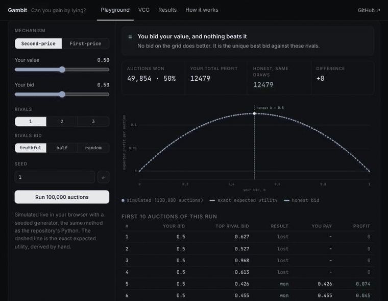
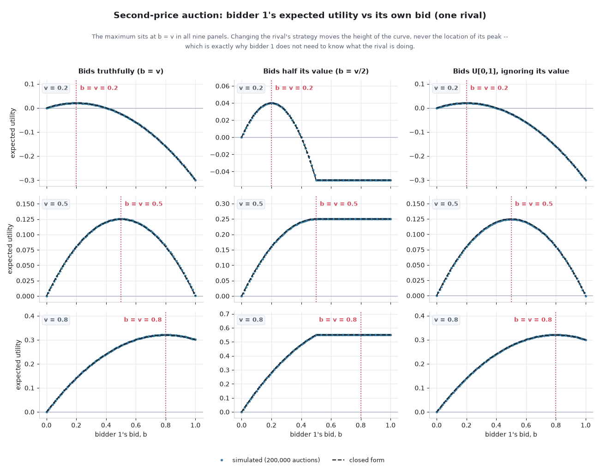
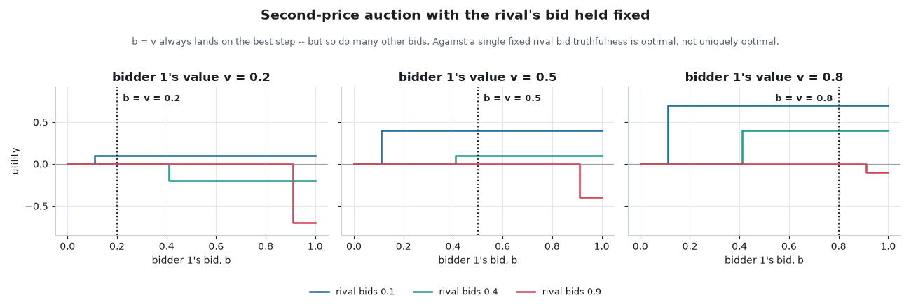
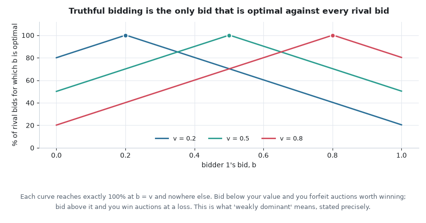
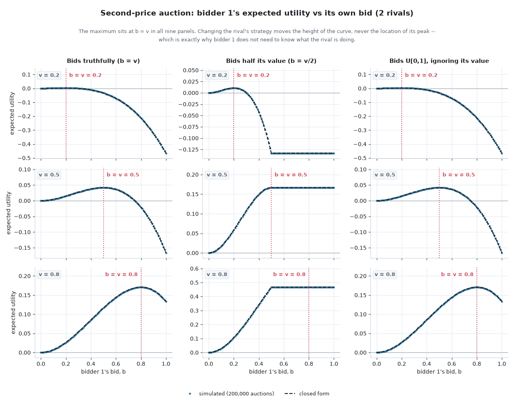
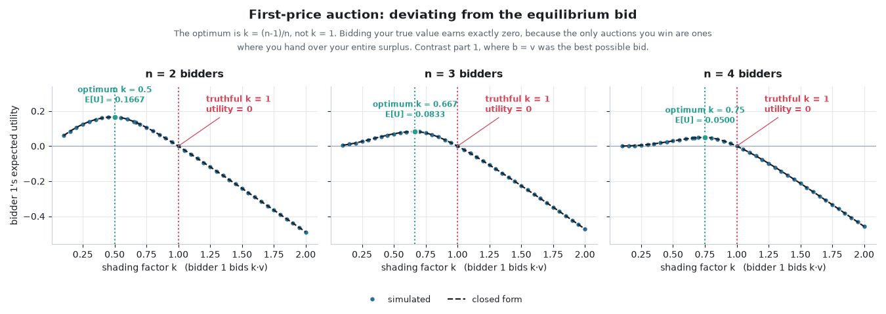
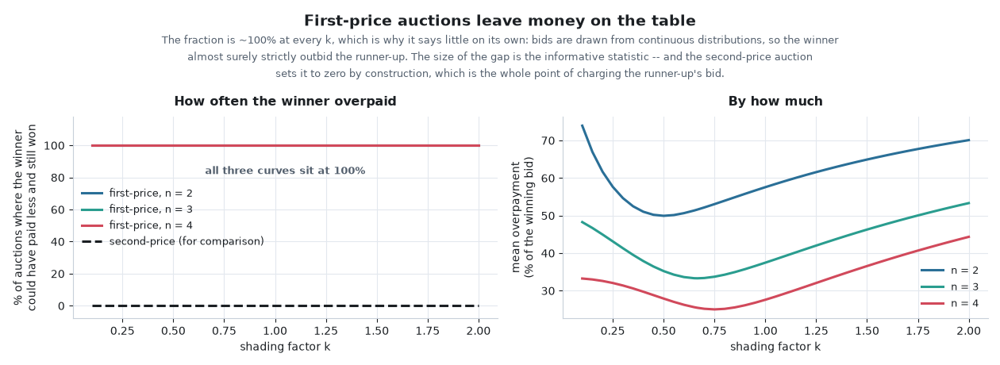
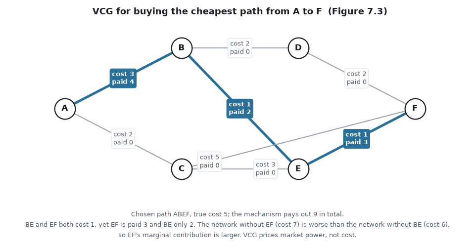
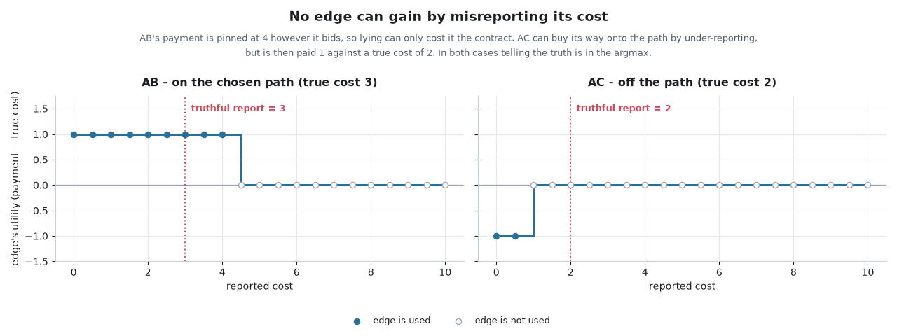

# Gambit: are these auctions safe to be honest in?

[](https://github.com/SreenityaThatikunta/mechanism-design/actions/workflows/ci.yml)


**You know what something is worth to you. Is there ever an advantage in pretending otherwise?**

Three auction mechanisms, each simulated 200,000 times per bid point and checked against a
closed form derived by hand: the **second-price (Vickrey)** auction, the **first-price** auction,
and **VCG** applied to buying the cheapest path through a network. In two of them lying cannot
help you. In the third, honesty earns you exactly nothing.

**Live demo: [gambit.sreenitya.in](https://gambit.sreenitya.in)**: pick a mechanism and a bid,
run 100,000 auctions in your browser, and watch what telling the truth would have earned on the
very same auctions you just played.

<p align="center"></p>

**Stack:** Python, NumPy, Matplotlib, pytest, ruff; vanilla JavaScript and SVG for the web demo,
deployed on Vercel.

**Author:** Sreenitya Thatikunta.

```bash
make install && make results && make test
make serve                   # interactive page at http://localhost:8000
```

---

## Results at a glance

| | Mechanism | Is truthful reporting optimal? | Evidence |
|---|---|---|---|
| **Part 1** | Second-price, 1–2 rivals | **Yes, weakly dominant.** `b = v` is the *only* bid that is optimal against every possible rival bid | [figures](#part-1--second-price-sealed-bid-auction) |
| **Part 2** | First-price, n = 2, 3, 4 | **No.** The optimum is `k = (n−1)/n`; bidding truthfully earns exactly **0** | [figures](#part-2--first-price-auction) |
| **Part 3** | VCG cheapest path | **Yes, dominant.** No edge, on or off the path, gains from any misreport | [figures](#part-3--vcg-for-the-cheapest-path) |

103 tests, all asserting against exact theory rather than stored snapshots.

---

## Part 1: second-price sealed-bid auction

Bidder 1 has a fixed value `v ∈ {0.2, 0.5, 0.8}` and bids `b ∈ {0.00, 0.01, …, 1.00}`. Each rival
draws a value from U[0,1] and bids (a) truthfully, (b) half its value, or (c) a fresh U[0,1] draw
ignoring its value. Bidder 1 pays the highest rival bid if it wins, so its utility is `v − m`.

**The mechanism works because `b` decides *whether* bidder 1 wins but never *what it pays*.**
Bidding above `v` only buys auctions that lose money; bidding below `v` only forfeits auctions
that would have profited.

### A. Expected utility against every bid, in 9 panels



**Yes, these plots help bidder 1 choose its strategy, and the reason is what they have in
common, not what distinguishes them.** The height and shape of the curve change across the nine
panels, but the location of the peak never does: it is at `b = v` in all nine. So bidder 1 can
pick its bid *without knowing which strategy the rival is playing*, which is the practical
content of dominance.

Two details the panels make visible:

- **Columns 1 and 3 are identical.** A rival bidding truthfully and a rival drawing a fresh
  U[0,1] both produce bids that are uniform on [0,1]. From bidder 1's side the two strategies
  are literally indistinguishable, so no simulation could separate them.
- **The middle column plateaus.** A rival that halves its value never bids above 0.5, so once
  `b ≥ 0.5` bidder 1 already wins every auction and extra bid buys nothing. For `v = 0.8` the
  maximum is a flat region `[0.5, 1.0]` containing `b = v`, not a spike at it.

### B. Against a fixed rival bid



With the rival's bid pinned at 0.1, 0.4 or 0.9, `b = v` is optimal in all nine combinations, but
it is **not uniquely** optimal, and saying otherwise would overstate the result. Against a rival
bidding 0.1 with `v = 0.5`, bids of 0.2, 0.5 and 1.0 all win and all pay 0.1. Typically 40–90
bids on the grid tie for best.

The sharp case is `v = 0.8` against a rival bidding 0.9: truthful bidding loses and earns 0,
while any winning bid earns `0.8 − 0.9 = −0.1`. Here honesty is strictly better.

So what makes `b = v` special? Not any single fixed rival bid, but the *whole range* of them:



Sweeping the rival's bid across [0,1], `b = v` is the **unique** bid optimal against every one of
them. Any `b < v` forfeits auctions when the rival bids between `b` and `v`; any `b > v` wins at a
loss when the rival bids between `v` and `b`. That is precisely what *weakly dominant* means.

### C. Two rivals



With a second rival the curves fall, since bidder 1 wins less often and pays more when it does, but
the peak stays at `b = v`. Competition changes the payoff, never the optimal strategy.

*(The brief's part 1C says "repeat parts A and C"; part B is clearly meant. For B with two rivals
both pinned at the same fixed bid, the highest rival bid is unchanged, so that check is identical
to the one-rival case by construction.)*

### Closed forms used to validate

With `k` rivals each bidding uniformly on `[0, s]` and `t = min(b, s)`:

```
E[u(b)] = (t/s)^k · (v − k·t/(k+1))       dE/db = (v − b)·f(b)
```

The derivative changes sign exactly at `b = v`. Special cases: `v·b − b²/2` for one truthful
rival, `v·b² − (2/3)·b³` for two. Max simulation-vs-theory error across all 18 configurations:
**0.0016**.

---

## Part 2: first-price auction

All `n` bidders draw from U[0,1]. Bidders 2…n play the symmetric equilibrium `b = ((n−1)/n)·v`.
Bidder 1 deviates, bidding `k·v` for `k ∈ [0.1, 2.0]`. The winner pays its own bid.



**The optimum is at `k = (n−1)/n`, not at `k = 1`.** This is the headline, and it is easy to
misread the brief as expecting a peak at truthful bidding. Truthful bidding (`k = 1`) earns
**exactly zero**, because the only auctions you win are those where you hand over your entire surplus.
This is the cleanest possible contrast with part 1.

| n | Equilibrium k | Simulated optimum | Exact E[U] = 1/(n(n+1)) | Simulated | E[U] at k = 1 |
|---|---|---|---|---|---|
| 2 | 0.5000 | 0.5000 | 0.166667 | 0.166455 | 0 |
| 3 | 0.6667 | 0.6667 | 0.083333 | 0.083307 | 0 |
| 4 | 0.7500 | 0.7500 | 0.050000 | 0.049867 | 0 |

The simulated argmax lands on the exact equilibrium for all three `n`. Deviating is costly in
both directions: under-shading wins too rarely, over-shading wins at too high a price, and any
`k > 1` has negative expected utility.

### Could the winner have paid less?



**Yes, in 100.00% of auctions.** But that number is ~100% *by construction*: bids are drawn from
continuous distributions, so the winner almost surely strictly outbid the runner-up. Reporting
the fraction alone would be close to meaningless, so the magnitude is reported too:

| n | Could have paid less | Mean overpayment | As % of winning bid |
|---|---|---|---|
| 2 | 100.00% | 0.1664 | 49.9% |
| 3 | 100.00% | 0.1665 | 33.3% |
| 4 | 100.00% | 0.1502 | 25.0% |

The winner routinely pays a quarter to a half more than it needed to. **In a second-price auction
this gap is zero by definition**, since the winner pays the runner-up's bid exactly. That is the whole
design argument for charging the second price, and it is why the left panel plots second-price as
a reference line at 0%.

---

## Part 3: VCG for the cheapest path

Figure 7.3 of Shoham & Leyton-Brown. Each **edge** is an agent with a private cost; the mechanism
buys a path from A to F. The payment to an edge on the chosen path is

```
p_e = L(cheapest path without e) − (L(chosen path) − cost_e)
```

that is, the cost of the best path that would exist without it, minus the cost of the rest of the path
actually chosen.



This reproduces the textbook result exactly: path **ABEF**, with **AB paid 4, BE paid 2, EF paid
3**, and every other edge paid **0**.

| Edge | Cost | On path | Best path without it | Payment | Utility |
|---|---|---|---|---|---|
| AB | 3 | yes | ACEF (6) | **4** | 1 |
| BE | 1 | yes | ACEF (6) | **2** | 1 |
| EF | 1 | yes | ABDF (7) | **3** | 2 |
| AC, BD, CE, CF, DF | - | no | ABEF (5) | 0 | 0 |

**BE and EF both cost 1, yet EF is paid 3 and BE only 2.** VCG prices *marginal contribution*,
not cost: the network without EF (7) is worse than the network without BE (6), so EF's absence
hurts more and it captures more surplus. Edges off the path are not pivotal: removing them
changes nothing, the two terms cancel, and they are paid zero.

### Can an edge gain by lying?



Sweeping each edge's reported cost over 0 → 10 in steps of 0.5, holding its true cost fixed:

- **AB (on the path, true cost 3).** Its payment is **pinned at 4 regardless of what it reports**,
  because the formula contains only *other* agents' costs. Under-reporting therefore changes nothing, and
  over-reporting past ~4 simply prices it off the path, dropping its utility from 1 to 0. There is
  no report that beats the truth.
- **AC (off the path, true cost 2).** Reporting below 1 does buy it onto the path, but it is then
  paid only 1 against a true cost of 2, for a utility of **−1**. The only way to win is to win at
  a loss.

The test suite runs this sweep for **all eight edges**, not just these two, and asserts truthful
reporting is in the argmax every time.

VCG is not free, though: it pays out **9** in total for a path that truly costs **5**. That gap
is the price of strategyproofness, and the reason VCG is not budget-balanced in procurement.

---

## How the results are validated

Monte Carlo that is only checked against other Monte Carlo can be confidently wrong. Every
simulated quantity here has an analytic counterpart:

| Quantity | Closed form | Where |
|---|---|---|
| Second-price E[u(b)], k rivals on [0,s] | `(t/s)^k (v − kt/(k+1))`, `t = min(b,s)` | `second_price.expected_utility_exact` |
| First-price E[U(k)], k ≤ (n−1)/n | `(1−k)(kn/(n−1))^(n−1)/(n+1)` | `first_price.expected_utility_exact` |
| First-price peak utility | `1/(n(n+1))` | `first_price.optimal_utility_exact` |
| VCG payments | exact arithmetic on shortest paths | `vcg_path.run_vcg` |

The uniform-bid assumption those formulas rest on is itself verified empirically rather than
assumed, by comparing each strategy's empirical CDF against its declared one.

Full numbers for every configuration are in [`results/summary.md`](results/summary.md),
regenerated by the pipeline. The reasoning behind the design, including the places where this
code deliberately disagrees with the brief, is in [`docs/DECISIONS.md`](docs/DECISIONS.md).

Other choices worth naming:

- **Common random numbers.** One block of rival draws is reused across every bid on the grid. Each
  estimate stays unbiased while differences between neighbouring bids become far less noisy, so
  the *shape* of the curve, which is what the plot is for, is estimated much more precisely at
  equal cost.
- **Seeded and reproducible.** One master seed, one independent child stream per part, so any part
  reproduces its full-run output in isolation.
- **Argmax *sets*, not a single argmax.** Where many bids tie, the code reports all of them.
  Collapsing to one would make the mechanisms look more sharply truthful than they are.
- **Explicit tie-breaking.** The network has genuine ties (ABDF and ACF both cost 7), so Dijkstra
  breaks them on the lexicographically smallest node sequence rather than leaving it to dict
  ordering.
- **Grid resolution.** The shading grid unions in the exact factors `(n−1)/n`; on a plain 0.05
  grid, `2/3` is absent and the n = 3 optimum would read as 0.65, a grid artifact rather than a result.
- **Reproducible to the byte.** CI reruns the whole pipeline and fails if any committed *number*
  (`docs/tables/`, `docs/data.json`) differs, so results cannot silently drift from the code that
  produced them. Figures are excluded from that check on purpose: matplotlib rasterises text via
  the platform font stack, so the same plot built on macOS and on Linux differs in bytes while
  being the same picture.

---

## Repository layout

```
src/mechanism_design/
├── config.py        experiment constants, seeds, grids
├── strategies.py    rival bidding rules + their bid CDFs
├── second_price.py  Part 1: simulation, closed forms, dominance profile
├── first_price.py   Part 2: shading sweep, overpayment statistics
├── vcg_path.py      Part 3: Dijkstra, VCG payments, misreport sweeps
├── plotting.py      figure rendering
└── cli.py           reproducible pipeline
tests/               103 tests, asserted against exact theory
docs/
├── DECISIONS.md     why the project is built this way
└── demo.gif
results/
├── summary.md       human-readable results, regenerated by the pipeline
└── tables/          generated CSVs
web/                 the deployed site (Vercel output directory)
├── index.html       Playground / VCG / Results / How it works
├── app.js           in-browser Monte Carlo, charts, Dijkstra + VCG
├── data.json        pipeline output the Results tab renders from
└── figures/         generated PNGs
```

| Command | Does |
|---|---|
| `make install` | create `.venv`, install the package and dev extras |
| `make results` | regenerate every figure and table (~4 s) |
| `make test` | run the test suite |
| `make lint` | run ruff |
| `make serve` | serve the interactive page locally |
| `python -m mechanism_design.cli part2` | run one part on its own |

---

## Reference

Y. Shoham and K. Leyton-Brown, *Multiagent Systems: Algorithmic, Game-Theoretic, and Logical
Foundations*, Cambridge University Press. Chapter 7 (mechanism design); Figure 7.3 and the worked
VCG example in §4.2. The textbook is not redistributed in this repository.
